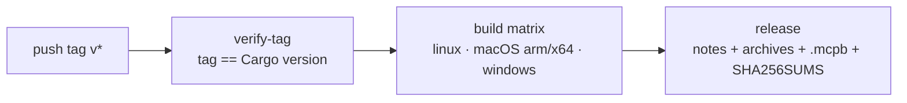

# Contributing to glyphtrail

## Branching: GitHub Flow

This repo uses [GitHub Flow](https://docs.github.com/en/get-started/using-github/github-flow):

- `main` is always releasable. Never commit to it directly.
- Branch off the latest `main` with a `feature/` prefix and a short kebab-case
  name, e.g. `feature/pin-lbug-prebuilt-version`. Use `feature/` for every
  change, including fixes, docs and dependency bumps. Dependabot's own
  `dependabot/...` branches are the only exception.
- Open a pull request against `main`. CI (`fmt-clippy-test` on stable and the
  MSRV toolchain, plus `workflow lint` when `.github/` changes) must be green
  before merging.
- PRs are squash-merged, so the PR title becomes the commit subject on `main`.
  Write it as a plain imperative sentence. The branch is deleted on merge.
- Releases are cut from `main`. There are no long-lived release or develop
  branches.

## Releasing

Bump `workspace.package.version` (and the lockstep `[workspace.dependencies]`
versions) in a PR, merge it, then tag the merge commit and push the tag:

```sh
git tag v0.3.0 && git push origin v0.3.0
```

The `release` workflow takes it from there. The GitHub Release is only created
once every target has built, so a broken target never leaves a half-populated
release behind. Tags with a pre-release suffix (`v0.3.0-rc.1`) become
pre-releases. Publishing to crates.io stays manual (`task publish`).



## Workflow security

The workflows are linted by [actionlint](https://github.com/rhysd/actionlint)
and [zizmor](https://docs.zizmor.sh/). When you touch `.github/`:

- Pin every action to a full commit SHA with the version as a trailing comment
  (`uses: owner/action@<sha> # v1.2.3`). Dependabot keeps the pins current.
- Start from `permissions: {}` at the workflow level and grant each job only
  what it needs, with a comment saying why.
- Check out with `persist-credentials: false`.
- Pass `${{ ... }}` values into `run:` scripts through `env:`, never inline.

Run the same checks locally with `task lint:actions` (needs
[uv](https://docs.astral.sh/uv/); set `GH_TOKEN` to enable zizmor's online
audits), or through the pre-commit hooks.

## Before opening a PR

```sh
task fmt   # rustfmt + sync bundled agent assets
task ci    # fmt check, clippy -D warnings, cargo check, tests
task lint:actions   # only if you changed .github/
```

If you edit `.claude/skills/glyphtrail/SKILL.md` or the managed section in
`CLAUDE.md`, run `task assets:sync` (or `task fmt`) so the copies bundled under
`crates/glyphtrail-cli/assets/` stay in sync.
